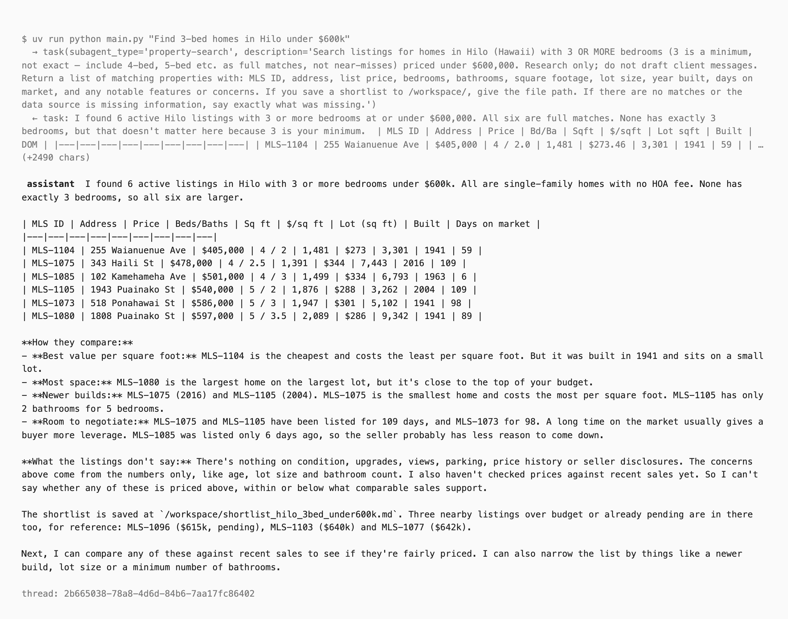
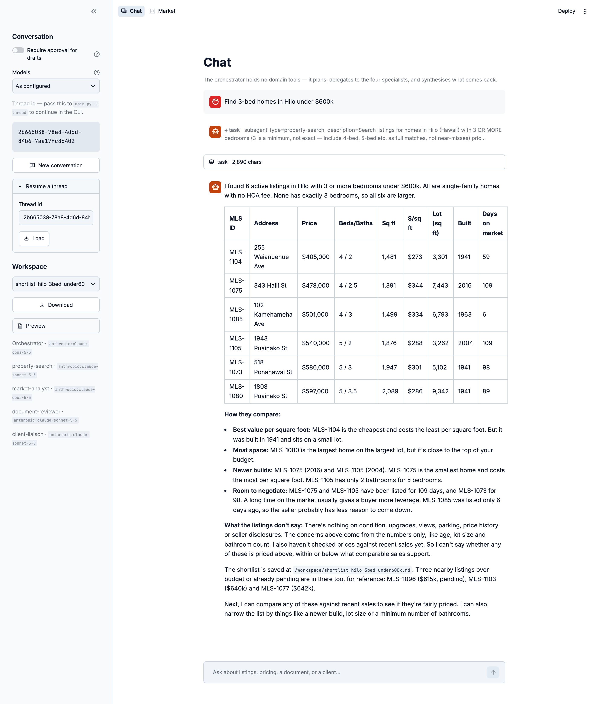
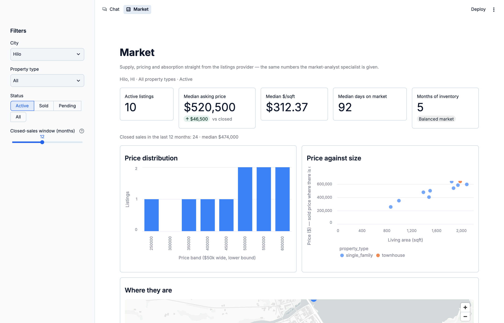
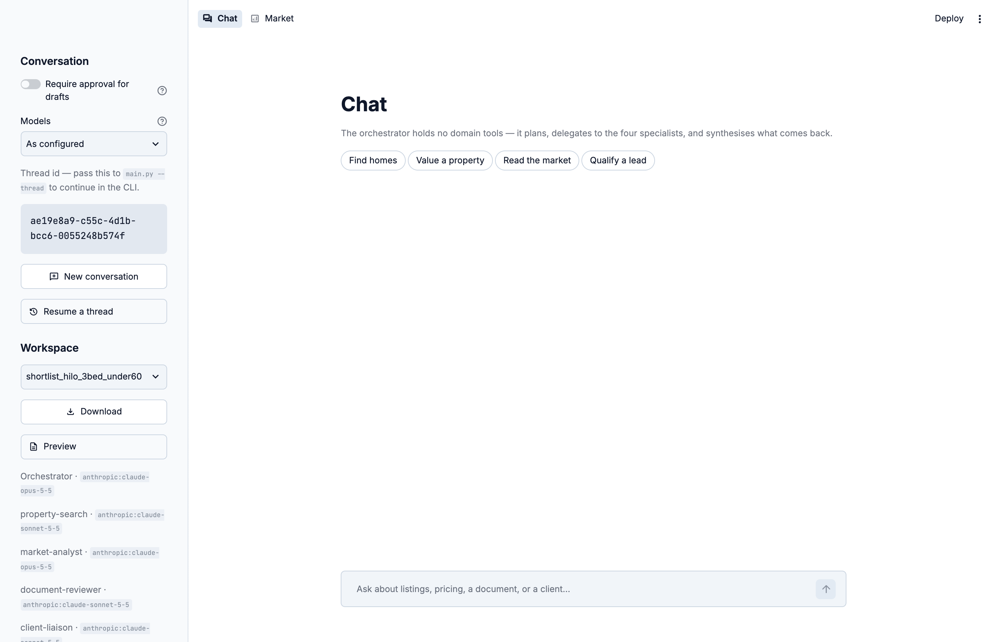

# Real Estate Agent

[](https://github.com/darylalim/real-estate-agent/actions/workflows/check.yml)

A multi-agent real estate assistant built on LangChain
[Deep Agents](https://docs.langchain.com/oss/python/deepagents/overview) and
Claude. It searches listings, runs comparative market analyses, reviews
documents, and drafts client emails. **It drafts; it never sends.**

The reasoning, measurements and defect history behind this README live in
[`docs/design-notes.md`](docs/design-notes.md).

## Quick start

```bash
cp .env.example .env    # add your ANTHROPIC_API_KEY
uv sync                 # Python 3.14, pinned by .python-version
uv run python main.py "Find 3-bed homes in Hilo under $600k"
```

| Command | Does |
|---|---|
| `uv run python main.py` | Interactive mode |
| `uv run python main.py --thread <id>` | Continue a conversation; every run prints its thread id |
| `uv run python main.py --require-approval` | Pause for approval before each `save_draft` |
| `uv run streamlit run streamlit_app.py` | The same agent in a browser, plus a market dashboard |

Conversations are checkpointed to `workspace/checkpoints.db`, so a thread
started in the CLI can be resumed in the browser, and vice versa.

<picture>
  <source media="(prefers-color-scheme: dark)" srcset="docs/images/cli-dark.png">
  
</picture>

## Web UI

- **Chat** — drives the real orchestrator, streams each delegation and tool
  result, and lists the files the specialists wrote to `/workspace/`. The
  sidebar holds the approval toggle and a **Models** picker (the configured
  build, or all-Opus 5.5).
- **Market** — supply, pricing and absorption over the listings provider. No
  model and no API key. Its headline numbers come from the agent's own
  `market_statistics` tool, so the dashboard cannot disagree with the analyst.

<picture>
  <source media="(prefers-color-scheme: dark)" srcset="docs/images/chat-run-dark.png">
  
</picture>

<picture>
  <source media="(prefers-color-scheme: dark)" srcset="docs/images/market-dark.png">
  
</picture>

<details>
<summary>Chat sidebar before a conversation</summary>

<picture>
  <source media="(prefers-color-scheme: dark)" srcset="docs/images/chat-idle-dark.png">
  
</picture>

</details>

Bind to loopback when running locally, since the app spends your API key:

```bash
uv run streamlit run streamlit_app.py --server.address 127.0.0.1
```

## Architecture

```
orchestrator  (write_todos + task)
├── property-search    search_listings, get_listing
├── market-analyst     find_comparables, market_statistics,
│                      search_listings, get_listing           → skills/cma-analysis
├── document-reviewer  list_documents, extract_document_text  → skills/document-review
└── client-liaison     qualify_lead, save_draft               → skills/client-comms
```

- **The orchestrator holds no domain tools.** It plans with `write_todos`,
  delegates with `task`, and combines what comes back.
- **Specialists share a filesystem, not context.** A long document review cannot
  crowd out the shortlist another specialist is maintaining.
- **Skills are declared per specialist**, not inherited. The three with
  methodology too large for a prompt (CMA grids, clause checklists, fair-housing
  rules) load one; `property-search` fits in its prompt.
- **Arithmetic happens in Python.** Medians, months of inventory and value
  ranges are computed by the tools, not by the model.

| Path | Purpose |
|---|---|
| `src/real_estate_agent/agent.py` | Orchestrator assembly, backend, permissions |
| `src/real_estate_agent/subagents.py` | The four specialist definitions |
| `src/real_estate_agent/tools/` | Tool groups, each bound to a data source |
| `src/real_estate_agent/providers/` | `ListingsProvider` protocol and mock feed |
| `skills/` | Methodology loaded on demand |
| `streamlit_app.py`, `app_pages/`, `ui/` | Web UI |
| `evals/` | LangSmith datasets and graders |
| `workspace/` | Agent scratch space (gitignored) |

## Listings data

**The default data source is a deterministic mock.** Every listing is synthetic.
It models two deliberately different Hawaii markets:

| Market | Active price range | Median | $/sqft | Months of inventory |
|---|---|---|---|---|
| Honolulu (96815, 96816) | $566k–$1.69M | $1.04M | $761 | 2.8 (seller's) |
| Hilo (96720) | $257k–$642k | $521k | $312 | 5.0 (balanced) |

To use a real feed, implement `search`, `get` and `comparables` from
`ListingsProvider` (`providers/base.py`) and return it from `default_provider()`
in `providers/__init__.py`. That is the only edit: the CLI and both web pages
read their provider from it, and no tool, specialist or prompt changes.

```python
def default_provider() -> ListingsProvider:
    return MyMlsProvider(api_key=...)
```

Two optional methods are worth adding:

- `comparables_with_diagnostics` (`DiagnosticListingsProvider`) tells the
  analyst what comp screening discarded.
- `markets()` (`MarketsListingsProvider`) lets the dashboard list every city
  without a search capped at 500 records.

To check a new provider, add it to `PROVIDERS` in the tests. The contract tests
then hold it to every rule in `providers/base.py`.

## Safety

- **No send capability.** `save_draft` writes a `.md`, an unsent `.eml`
  (`X-Unsent: 1`), and returns a `mailto:` link. A licensed human reads it and
  presses send.
- **Approval gate.** `--require-approval` (or the sidebar toggle) pauses each
  `save_draft`. It fails closed: no answer is a reject, and a paused thread
  cannot be resumed without the gate.
- **Write containment.** Writes are allowed only under `/workspace/`. `.env`,
  `.git` and the checkpoint database are denied; everything else is read-only.
  Rules are first-match-wins, so the allows must precede the catch-all deny.
- **Path traversal.** Document filenames come from model output, so they are
  confined to the documents directory before any read.
- **No shell.** The `execute` tool is listed but errors, because
  `FilesystemBackend` is not a sandbox.
- **Refusals.** Models that support it send `fallbacks: "default"`, so the API
  retries a declined request on a recommended model. A refusal nothing recovers
  becomes a short notice rather than an empty reply. Verified offline only.
- **Fair housing.** `client-comms` prohibits discriminatory listing language;
  `cma-analysis` forbids demographic adjustments.

The agent is an assistant, not a licensed professional. Its prompts push it to
recommend an attorney, appraiser or lender rather than act as one.

## Configuration

| Variable | Default | Notes |
|---|---|---|
| `ANTHROPIC_API_KEY` | — | Required |
| `LANGSMITH_API_KEY`, `LANGSMITH_TRACING`, `LANGSMITH_PROJECT` | — | Recommended. Legacy `LANGCHAIN_*` names still work and can switch tracing on |
| `REA_MODEL` | `anthropic:claude-opus-5-5` | Orchestrator. Keep the `provider:` prefix; the API-key check reads it |
| `REA_SUBAGENT_MODEL` | per role | All specialists. Unset (with `REA_MODEL` also unset) means Sonnet 5.5 for search, review and liaison, and Opus 5.5 for the analyst |
| `REA_MODEL_<ROLE>` | `REA_SUBAGENT_MODEL` | One specialist: `PROPERTY_SEARCH`, `MARKET_ANALYST`, `DOCUMENT_REVIEWER` or `CLIENT_LIAISON` |
| `REA_EFFORT` | API default | Orchestrator effort: `low`, `medium`, `high`, `xhigh` or `max` |
| `REA_SUBAGENT_EFFORT` | `REA_EFFORT` | All specialists |
| `REA_EFFORT_<ROLE>` | `REA_SUBAGENT_EFFORT` | One specialist |

Every trace is tagged `cli` or `web` and records the models, approval setting
and app version in its metadata.

## Development

Three checks, all offline with no API key needed:

```bash
scripts/check.sh            # all three, with pinned tool versions
scripts/check.sh --floor    # also runs the suite on Python 3.11
```

Or individually:

```bash
uv run pytest tests/ -q     # 142 tests, ~1.5s
uvx ty@0.0.91 check         # type check
uvx ruff@0.17.2 check .     # lint (ruff format is deliberately not used)
```

CI runs `scripts/check.sh --floor` and `uv sync --locked` on every push and PR.
When `version` in `pyproject.toml` names a new tag, a green push to `main`
publishes a GitHub release.

### Evaluations

`evals/` grades the live agent in LangSmith against two datasets built offline
from the mock:

| Dataset | Checks |
|---|---|
| `scenarios.json` | Correct facts (listing ids, months of inventory, comps, value range, lead tier) and correct delegation and tool use |
| `guardrails.json` | Fair housing, no send, write containment, checkpoint privacy, no invented listings, no legal opinions, no pressure tactics |

```bash
uv run python -m evals.build_datasets              # regenerate the JSON (offline)
uv run python -m evals.upload_datasets             # create or update in LangSmith; asks first
uv run python -m evals.run_experiments --limit 2   # LIVE and billed; asks first
uv run python -m evals.run_experiments --scenario cma-no-comps
```

Expected answers are computed from the agent's own tools, not recorded from a
model run. Runs cost about $0.06–$0.52 per example on the shipped models. See
[`docs/design-notes.md`](docs/design-notes.md#evaluations-in-depth) for the
graders, configurations and validating new rubric lines.
